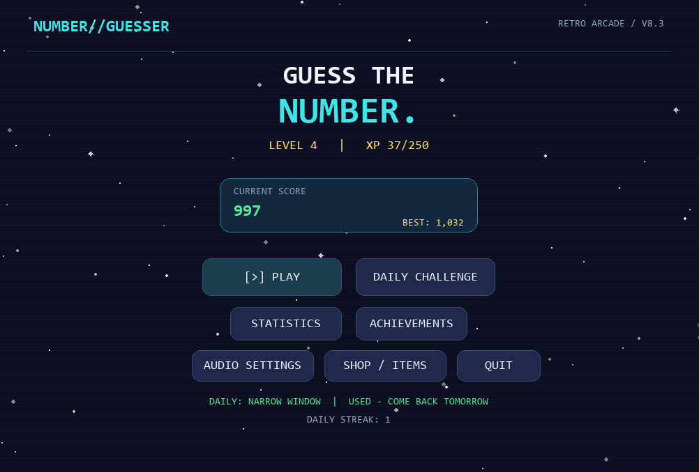

# NUMBER//GUESSER — Retro Arcade

A number guessing game built with Python and Pygame.

## Screenshot



## Run it
Open a terminal in this folder, then run:
```bash
python -m pip install -r requirements.txt
python main.py
```

## Controls
- Use the mouse to click menu buttons and select a difficulty.
- During a round, type a number and press **Enter** (or click **GUESS**).
- Press **Backspace** to correct a digit. Escape returns to the menu outside a live round; active rounds must be completed.
- Use **HINT** during a round to spend one hint from your inventory. Smart hints reveal either the secret number's parity (odd/even) or a tighter valid range.

## Progression: XP and levels
- Winning grants XP based on the reward and how many attempts remain; a loss still grants a small amount of XP.
- XP fills a level bar shown on the main menu and during a round. Level thresholds increase gradually, and level-ups are announced.
- Existing V6/V7 save files are migrated with sensible defaults for the new fields; your score, coins, themes, effects, achievements, hints, and unlocks remain intact.

## Daily challenge
- The **Daily Challenge** has a shared secret and rule set for a given calendar date.
- Challenge variants include Classic Signal, Odd Signal, Even Signal, Quickfire, Narrow Window, and Long Shot. The selection changes daily and never repeats on consecutive dates.
- The range, attempts, and point reward band depend on the daily variant. Odd/Even Signal guarantees the parity clue is true.
- A first daily victory gives a **100-coin bonus** plus bonus XP. Daily wins build a streak; missing a day or failing the daily challenge resets the streak. Only one daily attempt can be used per calendar date, win or lose. Attempt dates are saved to stop replaying a date by restarting the game or moving the system clock backward to a previously used date.

## Coins, score, and shop
- Score and coins are separate. Wins earn both; losses affect score but do not remove coins already banked. Coin payouts are now one quarter of earned points (minimum 5 coins), making Easy-mode repetition less profitable while preserving higher rewards for harder modes and fast wins.
- Lifetime coin earnings and spending are tracked separately. Theme/effect ownership and special-mode unlocks persist.
- Shop prices have been raised substantially so cosmetics, consumables, and special modes take more wins to unlock.
- The score reveal completes before the separate bank-coin animation appears, with the coin burst placed away from the score total.

## Modes and rewards
- **Easy:** 1–100, 10 attempts, 20–40 base points.
- **Medium:** 1–500, 15 attempts, 40–60 base points.
- **Hard:** 1–1000, 20 attempts, 60–80 base points.
- **Blitz (unlockable):** 1–250, 7 attempts, 60–90 base points; x4 for guesses 1–2 and x2 for guesses 3–4.
- **Survival (unlockable):** 1–1000, 9 attempts, 100–140 base points; x3 for guesses 1–3, x2 for guesses 4–6.
- The three core modes use x3 for guesses 1–3, x2 for guesses 4–6, then x1.
- Invalid guesses do not consume attempts. Higher/lower feedback updates the known range, and range hints never exclude the secret number.

## Statistics and polish
- Detailed statistics include win rate, average attempts, mode-by-mode wins, lifetime points, lifetime coins earned/spent, player level, and best daily streak.
- The animated starfield has subtle parallax, hover effects pulse gently, and coin rewards use small particle animations.
- The game has six color themes, three win effects, procedural arcade audio, music/SFX toggles, and a draggable music-volume slider.

## Save data
Progress is saved automatically in a stable user data folder: Windows `%APPDATA%/NumberGuesser/player_data.json`; macOS/Linux `~/.local/share/number-guesser/player_data.json`, unless `XDG_DATA_HOME` is set. Existing progress in the old project `data/player_data.json` is migrated when found. Re-extracting a new copy of the game does not normally erase progress.
